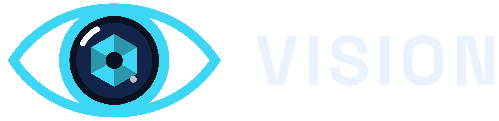
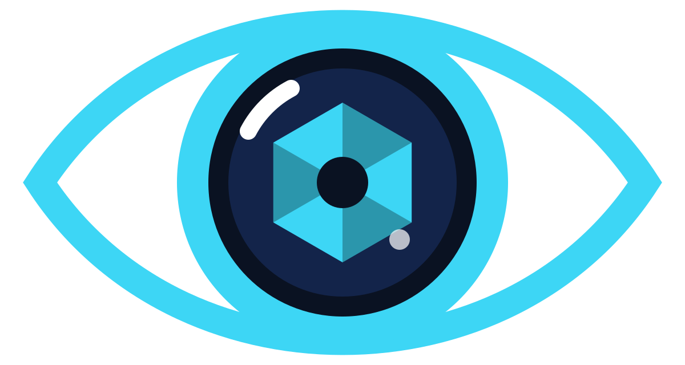

# Vision

Monitoramento inteligente de câmeras. Um olho que nunca pisca.

Vision é um sistema de vigilância e monitoramento de câmeras. A marca junta três ideias num símbolo só: o **olho** (quem vigia), a **lente** (a câmera) e a **íris facetada** (a inteligência por trás). Ela deve passar segurança, atenção constante e tecnologia, sem parecer ameaçadora.

---

## 1. O símbolo

O símbolo é um olho afilado com uma lente de câmera no lugar da íris. No centro da lente fica uma íris em hexágono, com facetas em dois tons e um reflexo de luz.

| Parte | O que representa |
| --- | --- |
| Contorno do olho | Vigilância, atenção |
| Anel da lente | A câmera, o equipamento |
| Vidro escuro (`lens-glass`) | Profundidade, o que a câmera vê |
| Íris facetada | Inteligência, análise das imagens |
| Reflexo | A lente "viva", ligada |

### Versão completa e versão simplificada

- **Completa**: com facetas e reflexo. Use a partir de **64 px** de largura na tela ou **25 mm** impresso.
- **Simplificada**: sem facetas, sem reflexo e com contorno mais grosso. Use abaixo de 64 px (favicon, ícones de menu, carimbos pequenos). Nunca use a completa em tamanho pequeno: as facetas viram borrão.

## 2. Versões do logo

| Versão | Quando usar |
| --- | --- |
| **Horizontal** (símbolo + nome lado a lado) | Versão principal. Site, sistema, cabeçalhos, assinatura de e-mail, documentos. |
| **Vertical** (símbolo em cima, nome embaixo) | Espaços quadrados ou altos: capa, crachá, adesivo, tela de login. |
| **Símbolo** | Quando a marca já está apresentada: ícone de app, avatar de redes sociais, marca-d'água no vídeo das câmeras. |
| **Nome** | Só em último caso, quando o símbolo não cabe (rodapé estreito, texto corrido). |

Cada versão tem quatro cores:

| Arquivo | Fundo |
| --- | --- |
| `cor-fundo-escuro` | Fundos escuros, de preferência o Azul-noite `surface-0`. **Esta é a versão preferida da marca.** |
| `cor-fundo-claro` | Fundos brancos ou claros. O ciano fica mais escuro para manter contraste. |
| `branco` | Fotos escuras, fundos coloridos, gravação em vidro ou metal, um só tom. |
| `preto` | Impressão em preto e branco, fax, carimbo, documentos oficiais. |

## 3. Área de proteção e tamanho mínimo

- **Área de proteção**: deixe livre ao redor do logo um espaço igual ao **diâmetro do anel da lente**. Nenhum texto, borda ou imagem entra nesse espaço.
- **Tamanho mínimo do logo horizontal**: 120 px de largura na tela, 30 mm impresso.
- **Tamanho mínimo do símbolo**: 16 px (simplificado) e 64 px (completo).

## 4. Usos incorretos

Para a marca ser reconhecida em qualquer lugar, ela precisa aparecer sempre igual. Não:

- esticar, achatar ou girar o logo;
- trocar as cores por outras fora desta paleta;
- separar o olho da lente ou mudar a posição do nome;
- aplicar sombra, brilho, contorno ou degradê;
- colocar a versão colorida sobre fotos ou fundos poluídos (use a branca);
- escrever "Vision" com outra fonte ao lado do símbolo: use sempre os arquivos prontos;
- usar o vermelho de alerta (`signal-rec`) no logo.

## 5. Cores

A marca é **escura primeiro**: o Azul-noite com o Ciano Sinal é a combinação que identifica a Vision. O tema claro existe para documentos, e-mails e telas que precisam de fundo branco.

| Nome | Escuro | Claro | Uso |
| --- | --- | --- | --- |
| Azul-noite · `surface-0` | `#0A1222` | `#F6F7FB` | Fundo principal |
| Painel · `surface-1` | `#111C33` | `#FFFFFF` | Cartões e painéis |
| Ciano Sinal · `brand` | `#3DD6F5` | `#0E7FA0` | Símbolo, destaques, gráficos |
| Gelo · `ink` | `#EAF2FF` | `#0E1530` | Texto principal |
| Névoa · `ink-muted` | `#9FB0C8` | `#4A5470` | Texto secundário |
| Gravando · `signal-rec` | `#FF5A5F` | `#C42A31` | Gravando, alerta, câmera offline |
| Online · `signal-ok` | `#34D399` | `#0B7A53` | Câmera online, tudo funcionando |

Regras:

- O ciano é a cor de destaque: botões principais, links, a câmera selecionada. Não pinte telas inteiras de ciano.
- Para texto em ciano sobre fundo claro, use `brand-text` (`#0A6E8C`), não `brand`. O `#0E7FA0` serve para o símbolo e elementos gráficos, mas fica fraco demais para texto pequeno.
- Vermelho e verde só indicam **estado** (gravando, offline, online), nunca decoração. Como muita gente não diferencia vermelho de verde, mostre o estado também com texto ou ícone ("● Gravando", "Online").

## 6. Tipografia

| Uso | Fonte | Peso |
| --- | --- | --- |
| Logo, títulos, números grandes do painel | **Space Grotesk** | 700 (títulos) / 500 (subtítulos) |
| Textos, menus, botões, tabelas | **Inter** | 400 (texto) / 500 (rótulos e botões) |

As duas são gratuitas no Google Fonts. A Space Grotesk tem cara de tecnologia e conversa com o desenho do logo. A Inter é muito legível em telas pequenas e em tabelas cheias de números, o que importa num painel de câmeras.

O nome **VISION** no logo é a Space Grotesk 700, em maiúsculas, com espaçamento de 8% entre as letras. Nos arquivos o nome já está convertido em desenho: não precisa ter a fonte instalada para usar o logo.

## 7. Tom de voz

A Vision fala com donos de empresa, síndicos e gerentes, não com técnicos. O texto deve ser:

- **Calmo e seguro**: "Tudo certo: 12 câmeras online." em vez de "ATENÇÃO! Status do sistema verificado."
- **Simples**: "A câmera da garagem parou de gravar" em vez de "Falha no stream RTSP do dispositivo 04".
- **Direto na ação**: quando algo dá errado, diga o que aconteceu e o que fazer. "Câmera da recepção sem sinal. Verifique se ela está ligada na tomada."
- Evite tom de medo ou de filme policial. A marca vende tranquilidade, não ameaça.

## 8. Ícones e elementos gráficos

- Ícones de traço (linha), com 2 px de espessura e pontas arredondadas, na cor `ink` ou `brand`.
- Recurso gráfico da marca: **arcos e anéis concêntricos** tirados da lente. Funcionam como fundo de capas, banners e tela de login, sempre discretos.
- Nada de olhos realistas, fotos de câmeras com aparência agressiva ou imagens de "hacker".

## 9. Arquivos

Todos os arquivos ficam na aba **Assets** deste guia (em SVG, que pode ser ampliado sem perder qualidade) e no pacote `vision-brand-kit.zip` (SVG e PNG):

- `svg/` — vetores para gráfica, site e sistema
- `png/` — imagens prontas para Word, PowerPoint, WhatsApp e redes sociais
- `icone/` — ícone de app (1024, 512, 180 px), ícone quadrado para redes sociais e favicon (32 e 16 px)

## 10. Pendências

- **Registro do nome**: "Vision" é um nome muito usado no mercado de câmeras. Antes de investir em material impresso, faça uma busca no INPI e considere um complemento para o registro.
- O símbolo é original e não usa nenhum elemento de personagens ou marcas de terceiros.
